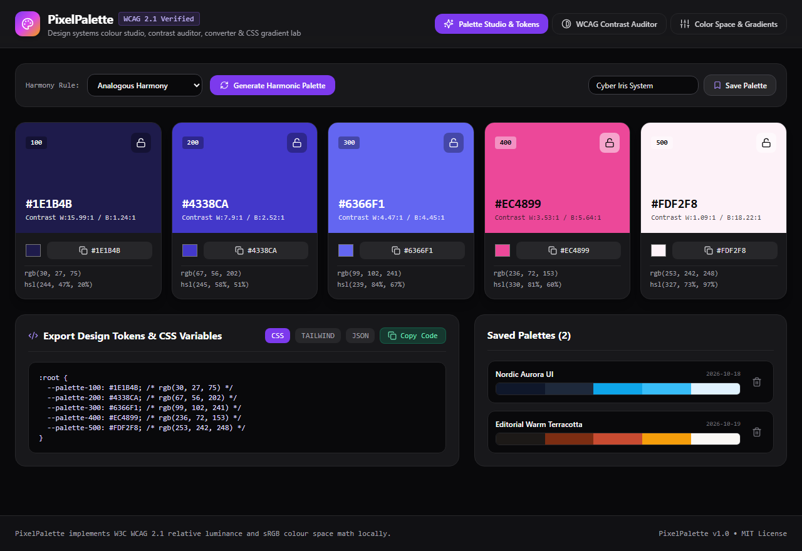
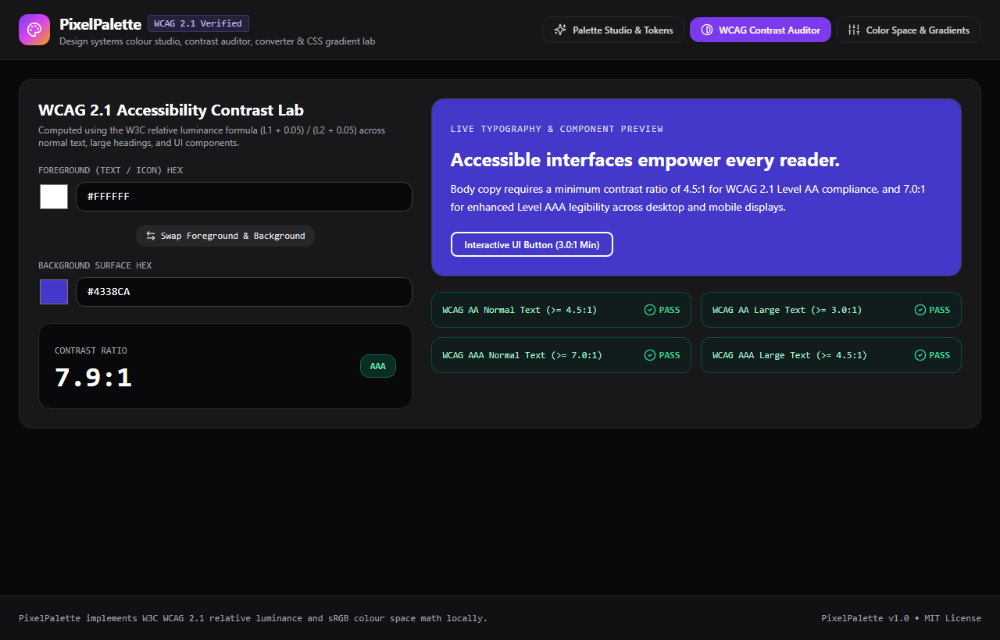
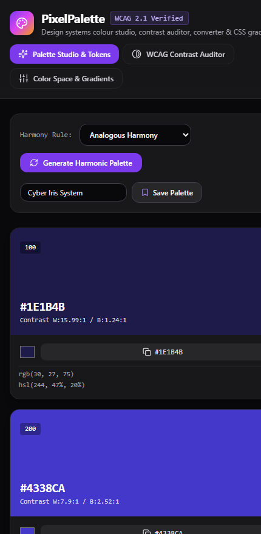

# PixelPalette — Design Systems Colour Studio & WCAG Contrast Lab

[](https://opensource.org/licenses/MIT)
[](https://www.typescriptlang.org/)
[](https://react.dev/)
[](https://github.com/iamnarace/pixelpalette/actions/workflows/ci.yml)

**PixelPalette** is a colour and design-systems workbench for frontend engineers and product designers. It combines harmonic palette generation, exact W3C WCAG 2.1 contrast auditing, bi-directional `HEX` / `RGB` / `HSL` conversion, multi-stop CSS gradient authoring, and one-click design token export.

---

## Why PixelPalette?

Building accessible interfaces requires verifying text contrast against background surfaces, maintaining consistent colour harmonies, and exporting tokens into CSS variables or Tailwind configurations. **PixelPalette** unifies these workflows in a single dark-chromatics studio where every swatch displays live contrast ratios against both white and dark surfaces.

---

## Key Features

- **Harmonic Palette Generator:** Generate 5-swatch palettes using *Analogous*, *Complementary*, *Triadic*, *Split-Complementary*, or *Monochromatic* colour theory rules. Lock individual swatches while regenerating the rest.
- **Exact W3C WCAG 2.1 Contrast Auditor:** Calculates relative luminance $L = 0.2126R + 0.7152G + 0.0722B$ and contrast ratio $(L_1 + 0.05) / (L_2 + 0.05)$ with instant pass/fail badges for **AA Normal (4.5:1)**, **AA Large (3.0:1)**, **AAA Normal (7.0:1)**, and **AAA Large (4.5:1)**.
- **Bi-Directional HEX • RGB • HSL Converter:** Inspect and edit colour channels across sRGB and HSL spaces with real-time synchronization.
- **3-Stop CSS Gradient Composer:** Build linear (0°–360°) and radial gradients and copy production CSS declarations.
- **Design Token Exporter & Saved Library:** Export any palette as CSS Custom Properties (`:root`), a `tailwind.config.js` snippet, or W3C Design Token JSON, and save favourite palettes to `localStorage`.

---

## Screenshots

### Desktop — Harmonic Palette Studio & Design Token Exporter


### Feature View — WCAG 2.1 Accessibility Contrast Lab


### Mobile Responsive View
<p align="left">
  
</p>

---

## Technology Stack

- **Framework:** React 18 + TypeScript 5
- **Styling:** Tailwind CSS (Neutral Dark Chromatics studio theme)
- **Icons:** Lucide React
- **Build & Test:** Vite 6, Vitest 4, React Testing Library, ESLint

---

## Requirements & Installation

- **Node.js:** v20+ LTS recommended (v18.18+ supported for build/runtime)
- **npm:** v9+

```bash
# Clone the repository
git clone https://github.com/iamnarace/pixelpalette.git
cd pixelpalette

# Install dependencies
npm install
```

---

## Local Development, Build & Testing

```bash
# Start local development server
npm run dev

# Run ESLint check
npm run lint

# Run Vitest unit & component tests
npm test

# Build production bundle
npm run build
```

---

## Usage Guide

1. **Generate & Lock Swatches:** In **Palette Studio & Tokens**, choose a harmony rule and click **Generate Harmonic Palette**. Click the lock icon on any swatch you want to keep while regenerating the remaining colours.
2. **Export Tokens:** Switch between **CSS**, **TAILWIND**, and **JSON** in the token exporter and click **Copy Code**.
3. **Audit Contrast:** Switch to **WCAG Contrast Auditor** to test foreground/background pairs against WCAG 2.1 AA and AAA thresholds.
4. **Convert & Build Gradients:** Open **Color Space & Gradients** to convert between HEX/RGB/HSL or compose 3-stop CSS gradients.

---

## Project Structure

```text
pixelpalette/
├── .github/
│   ├── ISSUE_TEMPLATE/
│   ├── workflows/ci.yml
│   └── pull_request_template.md
├── docs/
│   └── screenshots/
├── src/
│   ├── test/
│   │   ├── colorEngine.test.tsx
│   │   └── setup.ts
│   ├── utils/
│   │   └── colorEngine.ts
│   ├── App.tsx
│   ├── index.css
│   └── main.tsx
├── CHANGELOG.md
├── CONTRIBUTING.md
├── LICENSE
├── SECURITY.md
├── package.json
└── vite.config.ts
```

---

## Security & Privacy Considerations

- **Local Execution & Storage:** All colour calculations execute in the browser. Saved palettes persist in `window.localStorage` on your device.

---

## Known Limitations

- **sRGB Colour Gamut:** Calculations operate in standard 8-bit sRGB (`#RRGGBB`) and HSL spaces; wide-gamut `oklch()` / Display-P3 colour spaces are planned for a future release.
- **WCAG 2.1 Luminance Formula:** Contrast checks use the published W3C WCAG 2.1 relative luminance algorithm rather than the experimental WCAG 3.0 APCA draft.

---

## Roadmap

- [ ] `oklch()` and Display-P3 wide-gamut colour space support
- [ ] Colour-vision deficiency (Protanopia, Deuteranopia, Tritanopia) simulation preview
- [ ] SVG swatch card download

---

## Contributing

Contributions are welcome! Please read [CONTRIBUTING.md](./CONTRIBUTING.md) before submitting a pull request.

---

## Acknowledgements

Developed with assistance from Google Antigravity.

---

## License

Licensed under the [MIT License](./LICENSE). Copyright (c) 2026 Naresh Adhikari.
